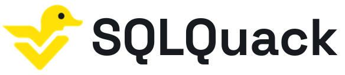
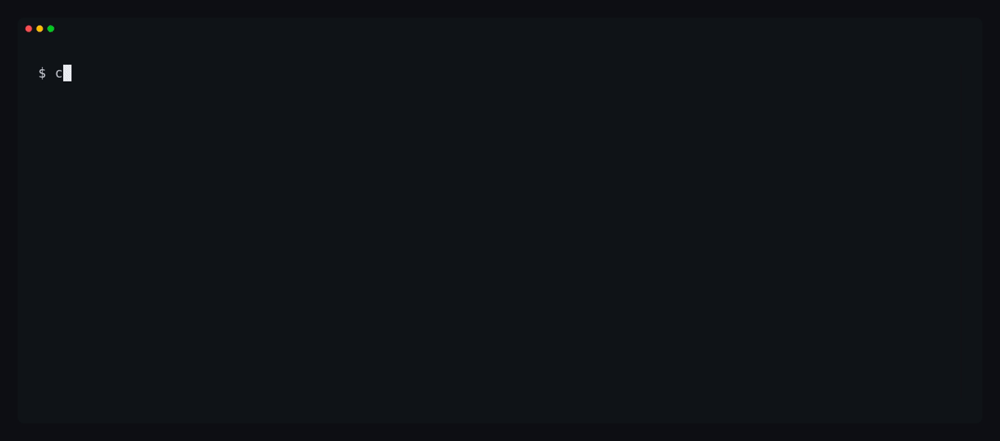

<p align="center">
  <picture>
    <source media="(prefers-color-scheme: dark)" srcset="https://raw.githubusercontent.com/sqlstack-io/sqlquack/main/.github/sqlquack-logo-dark.png">
    <source media="(prefers-color-scheme: light)" srcset="https://raw.githubusercontent.com/sqlstack-io/sqlquack/main/.github/sqlquack-logo-light.png">
    
  </picture>
  <br>
  <sub>by <a href="https://sqlstack.io">SQLStack</a></sub>
</p>

<h3 align="center">Run warehouse SQL locally.</h3>

<p align="center">
  Translate warehouse SQL into DuckDB SQL for local testing and CI - without a running warehouse.
  <br>
  <a href="https://sqlquack.io/">Website</a> ·
  <a href="https://sqlquack.io/docs/">Docs</a> ·
  <a href="https://sqlquack.io/playground/">Playground</a> ·
  <a href="https://sqlquack.io/docs/quickstart/">Quickstart</a>
</p>

<p align="center">
  
</p>

## Why SQLQuack?

SQL that runs on two engines doesn't always return the same answer. NULLs, decimal arithmetic and casts can behave differently.

SQLQuack checks its conversion rules against real results from the source warehouse. It handles those differences deliberately and gives you precise diagnostics when it can't convert a query - not plausible-looking SQL and crossed fingers.

- **Check early.** Catch invalid SQL before it reaches the warehouse.
- **Test locally.** Convert queries to DuckDB SQL for tests against small fixtures.
- **See what's blocking you.** Scan a SQL project to find what converts and what needs attention.
- **Choose what to accept.** Control known differences through an explicit policy.

## Get started

```bash
pip install sqlquack

# Convert your first query
echo "SELECT 1 AS total" | sqlquack convert --builtin-policy

# Check a SQL file
sqlquack check query.sql

# Convert a query using the tables in sources/*.yml
sqlquack convert query.sql
```

Or **[try the playground](https://sqlquack.io/playground/)** - no installation needed.

See the [supported dialects and coverage](https://sqlquack.io/docs/coverage/), [project guide](https://sqlquack.io/docs/project/) and [conversion policy](https://sqlquack.io/docs/policy/) for the details.

## Use it from Python

```python
import sqlquack

result = sqlquack.convert(
    sql="SELECT 1 AS total",
    options=sqlquack.ConvertOptions(builtin_policy=True),
)
```

[Python API](https://sqlquack.io/docs/python/)

## Running the suites

SQLQuack's parsers and conversion rules are checked against evidence recorded on the real engines. Rerunning it needs no account:

```bash
git clone https://github.com/sqlstack-io/sqlquack && cd sqlquack
uv sync
make check-syntax DIALECT=snowflake    # rerun the parser against recorded syntax evidence
make check-convert DIALECT=snowflake   # replay recorded translations on DuckDB
```

| Command | What it does |
|---|---|
| `make pending DIALECT=snowflake` | What isn't recorded yet, in both suites |
| `make check-syntax DIALECT=snowflake` | Rerun the parser against recorded evidence (offline) |
| `make record-syntax DIALECT=duckdb` | Record evidence for new syntax cases |
| `make check-convert DIALECT=snowflake [CASES=temporal]` | Replay recorded translations on DuckDB (offline) |
| `make record-convert DIALECT=snowflake` | Record new translation cases on Snowflake |

Recording needs the dialect's engine: DuckDB and SQLite record locally, while Snowflake, BigQuery and Databricks need a connection. Recording Snowflake syntax evidence isn't public yet. `make help` lists every target.

---

Built in Rust. Free and open source. [Apache 2.0](https://github.com/sqlstack-io/sqlquack/blob/main/LICENSE).

Part of [SQLStack](https://sqlstack.io/).
